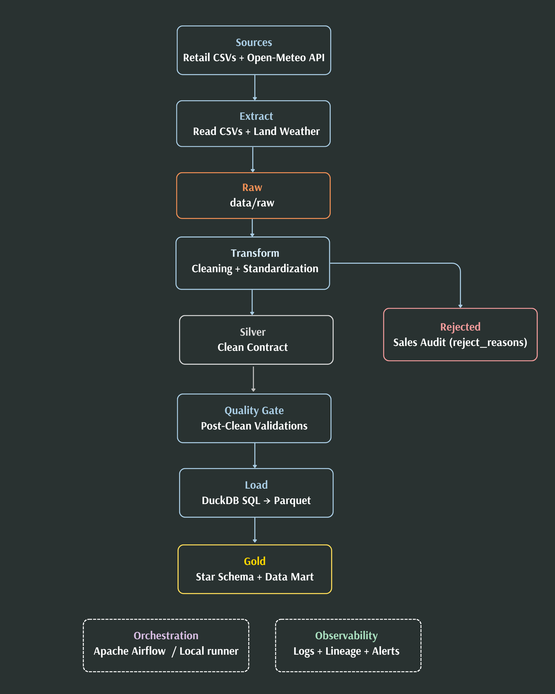
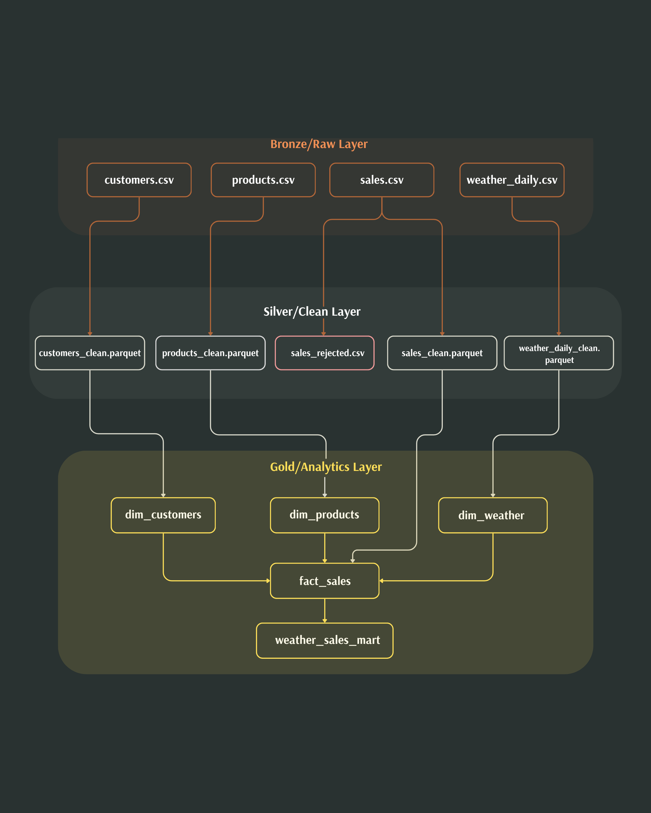
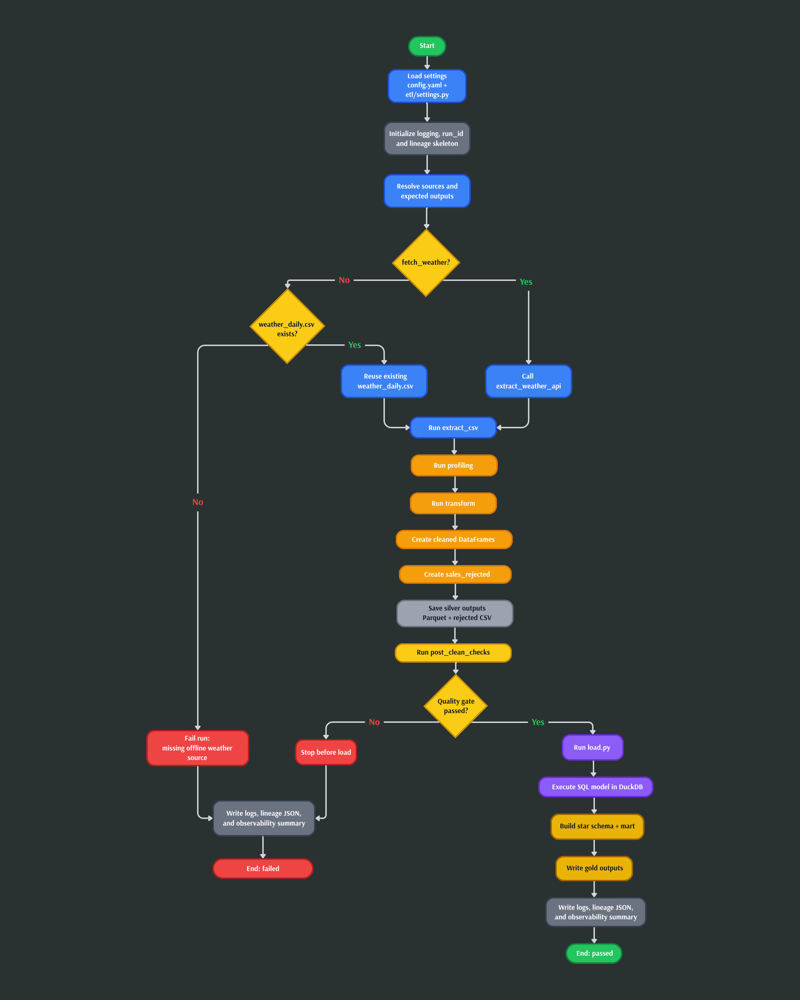
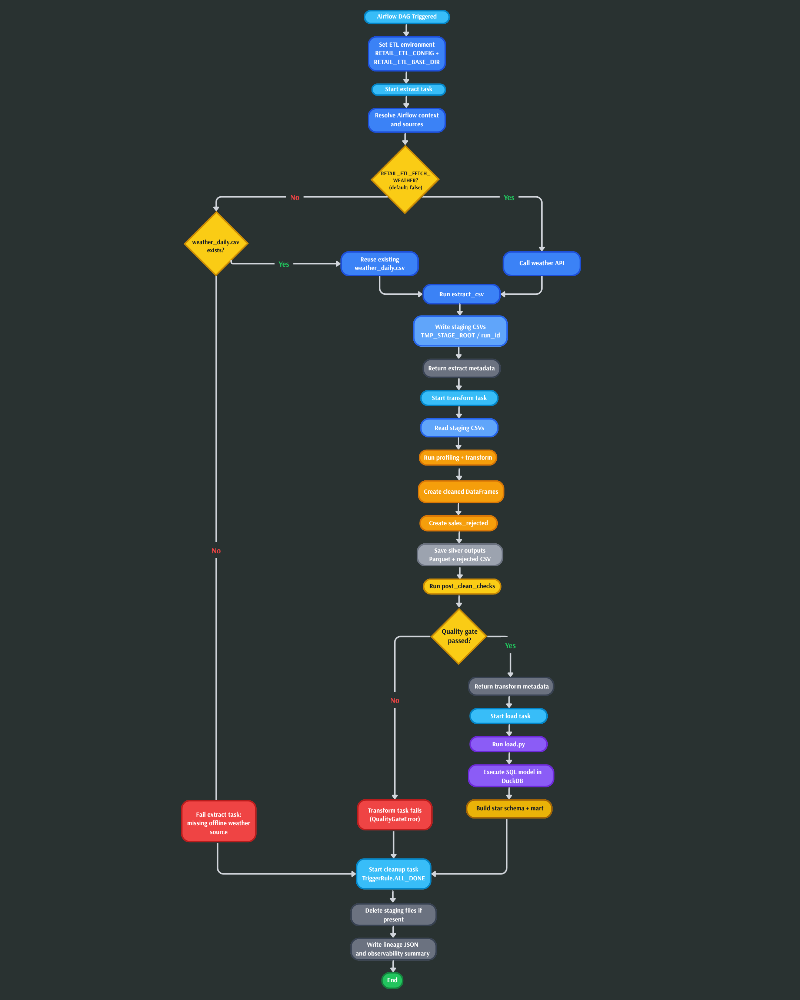
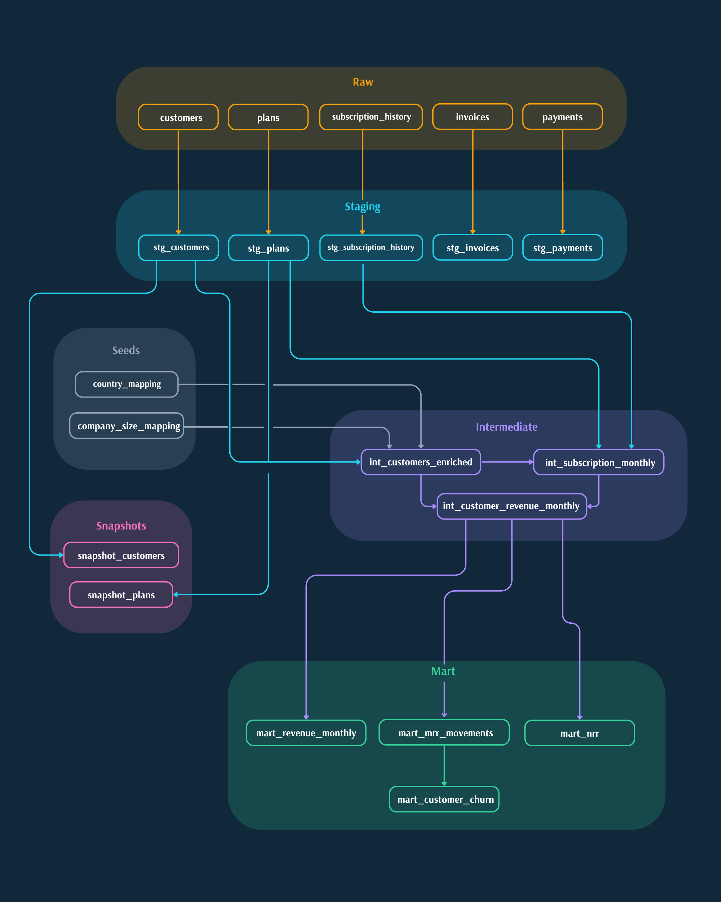
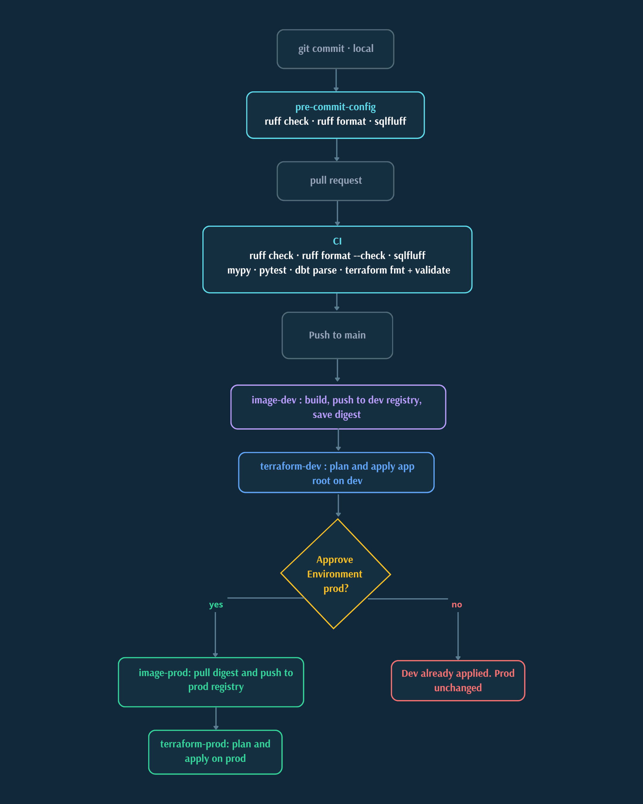
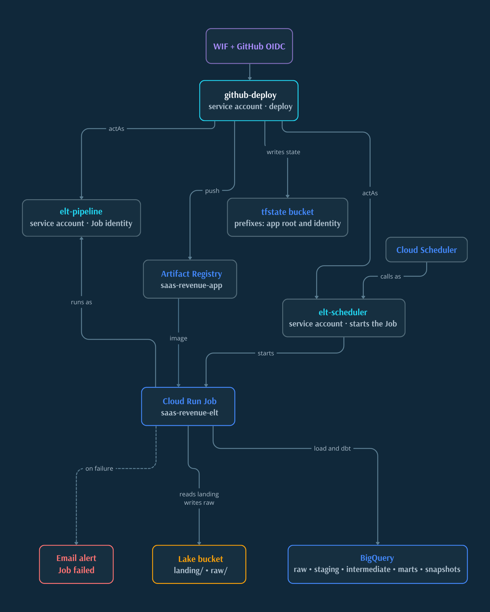

# Hi, I'm Dani 👋

  

---

## About me

---

My name is Dani, a developer based in Barcelona, Spain, building my career in Data Engineering.

I'm passionate about turning raw, messy data into reliable and well-structured data systems. I learn through hands-on, production-oriented projects, focusing not only on making things work, but on making them maintainable, reproducible, and scalable.

I'm constantly learning, building, and pushing myself to become a better engineer.

---

## Projects

---

### 🛍️ [retail-weather-etl](https://github.com/Danij4ne/retail-weather-etl)

---

**Business:** Retail analytics focused on understanding how weather affects sales by city and product category.

**Architecture:** Local-first ETL with a Medallion architecture (raw → silver → gold), rejected sales for audit, full-refresh processing, and a star schema + analytical mart.

**Analytics:** Units sold, orders, net revenue, average ticket, temperature, precipitation, rain/temp buckets, and price coverage.

**Diagrams:**

<table>
  <tr>
    <td align="center" width="25%">
      
       
      Data flow
    </td>
    <td align="center" width="25%">
      
       
      Data layers
    </td>
    <td align="center" width="25%">
      
       
      Local execution
    </td>
    <td align="center" width="25%">
      
       
      Airflow execution
    </td>
  </tr>
</table>

---

### 📈 saas-revenue-elt 

---

**Business:** SaaS subscription revenue analytics focused on revenue movements and customer retention.

**Architecture:** Append-only raw loads; dbt staging views → intermediate tables → analytical marts, with intermediate and marts rebuilt on full refresh.

**Analytics:** MRR, ARR, ARPU, MRR movements, logo churn, monetary churn, and 12-month NRR.

**Diagrams:**

<table>
  <tr>
    <td align="center" width="25%">
      
       
      Data flow
    </td>
    <td align="center" width="25%">
      
       
      Data layers
    </td>
    <td align="center" width="25%">
      
       
      Commit to deploy
    </td>
    <td align="center" width="25%">
      
       
      GCP infrastructure
    </td>
  </tr>
</table>